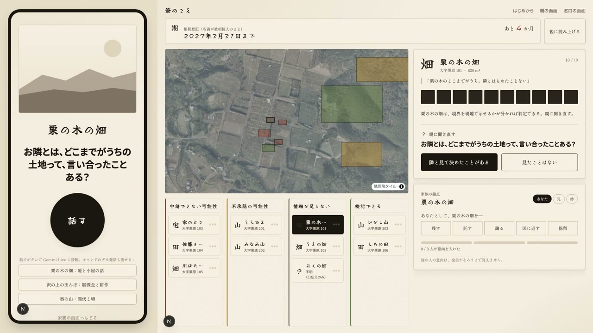
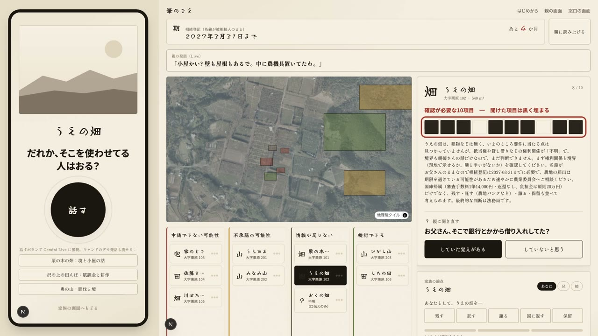
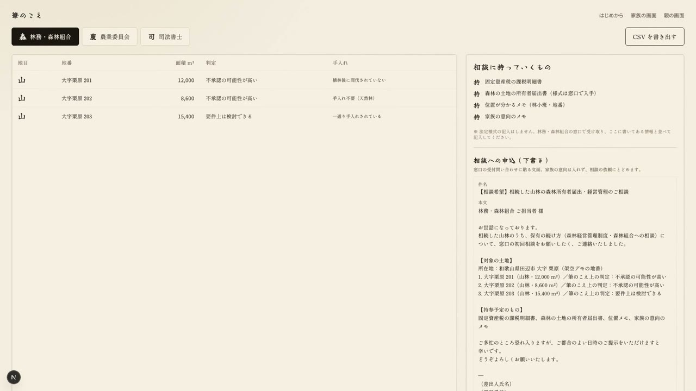
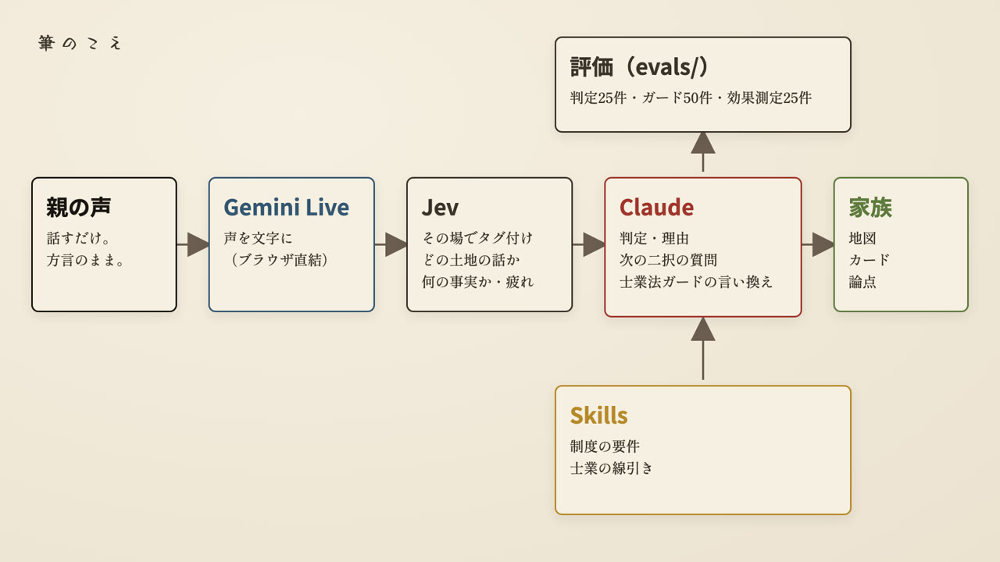
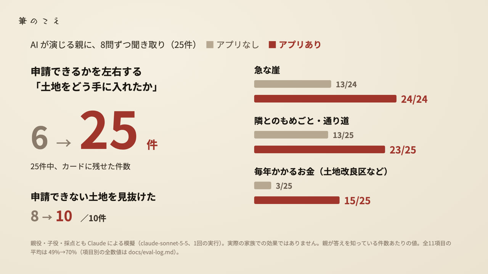

# 筆のこえ

離れて暮らす家族が、70代の親の記憶にしかない土地の事実を、親が元気なうちに「制度が求める形」で聞き切るための Web アプリ。Built with Claude: Japan 2026 の応募作品（テーマ：本来、誰にでも届くべきものを。）。

- デモ動画（3分）：（YouTube の URL）
- 公開デモ：https://fudekoe.okita.dev （架空の集落「大字 栗原」のデータ）

「筆（ひつ）」は登記で土地を数える単位。一筆ごとに、親の話から必要な証言を集める。

## 解く課題

山林や農地を相続しても、境界・小屋・誰が使っているかを知っているのは親だけ、ということがよくある。相続土地国庫帰属制度で国に引き取ってもらおうとしても、境界が分からない、手入れされていない森林、といった理由で却下・不承認になる。親が亡くなってからでは、もう誰にも聞けない。

制度は誰にでも開かれているのに、要件を知らない家族には使えない。このアプリは、要件を知らなくても必要な証言がそろうようにする。

## 使う場面：聞き直しループ

週末のビデオ通話。親はスマホの大きなボタンを押して方言のまま話すだけ。子は家族の画面を操作する。



1. 親の一言（「栗の木のとこの畑やけどな」）→ どの土地の話かを推定し、筆カードに書き込む
2. 制度の要件と照らして、足りない証言を見つける（境界・建物・他人の使用など10項目）
3. 足りない証言を二択の質問にして、子が親に読み上げる（親の画面にも同じ質問が大きく出る）
4. 親が答えるとマスが黒く埋まり、筆が判定レーンを移る



家族は「残す／託す／譲る／国に返す／保留」を各自非公開で選ぶ。一人の意見に引っぱられず、全員が一致した筆から先に決められる。割れた筆は保留にまわす。最後に、市町村の林務担当・農業委員会・司法書士へ、それぞれに要る列だけの一覧（CSV）と、相談に持っていく物のリストを渡す。



### 3つの画面

| 画面 | 使い手 | URL |
| --- | --- | --- |
| 親の画面 | 親（話すだけ） | `/parent` |
| 家族の画面 | 子（地図・筆カード・判定レーン・家族の論点） | `/family` |
| 窓口の画面 | 林務担当・農業委員会・司法書士 | `/counter` |
| はじめの5分 | 子（町名 → 課税明細書 → 筆一覧） | `/` |

親の画面には「相続」「処分」「国に返す」「申請」などの言葉を出さない。判定は家族の画面だけに出す。

### 線引き

士業の仕事はしない。書類作成・境界の断定・遺産分割の個別助言・個別の税額・承認の断定は行わず、相談先と持参物に置き換える。境界の証言は「参考」として持ち、地図に境界線は引かない。山の値段や担い手不足は解かない。

## しくみ



| 役割 | 担当 | コード |
| --- | --- | --- |
| 親の声を文字に | Gemini Live API（ブラウザから直接。キーはサーバーで ephemeral token にして渡す） | `src/lib/gemini-live.ts`、`src/app/api/gemini/token` |
| その場のタグ付け：どの土地の話か・要件に関わる事実か・疲れ具合（約0.4秒） | Jev（TypeSafe AI）の choice／noul／score | `src/lib/jev.ts`、`src/app/api/jev/tag` |
| 判定・理由・次の二択の質問・士業法ガードの言い換え | Claude API（claude-sonnet-5-5、tool use） | `src/lib/claude.ts`、`src/app/api/{judge,next-question,guard}` |
| 制度のルールと士業の線引き | Skills。開発中の Claude Code と、本番のシステムプロンプトで同じ文書を使う | `.claude/skills/*` → `npm run skills:bundle` で `src/lib/skills.generated.ts` に同梱 |
| 親の画面と家族の画面の中継 | BroadcastChannel（同じブラウザの別タブ） | `src/lib/bridge.ts` |

Claude のキーがないときは、同じ判定をルールで行うモック（`src/lib/judge.ts`・`guard.ts`・`next-question.ts`）に切り替わる。評価スクリプトの `--mock` も同じコードを使う。

## 評価

機能を足す前に数字を取る、を原則にした。経緯（失敗した回を含む）は [docs/eval-log.md](docs/eval-log.md)、予測ファイルは `runs/`。



| 測ったこと | 結果 |
| --- | --- |
| アプリの効き目：AI の親役に8問ずつ聞き取り（25件）。申請できるかを左右する「土地をどう手に入れたか」がカードに残った件数 | アプリなし 6件 → **アプリあり 25件** |
| 同上、申請できない土地（10件）を正しく見抜けた | 8件 → **10件** |
| 同上、急な崖／隣とのもめごと・通り道／毎年かかるお金 | 13→**24**／13→**23**／3→**15** |
| 同上、全11項目の平均（正誤込み）・判定の一致 | 49% → **70%**・72% → **84%** |
| 制度の判定（25件）：Skills なし → あり | 84% → **100%**（2回とも） |
| 士業法ガード（50件）：止めるべき入力を止めた／止めすぎ | 96〜100%／**0件** |

注意：
- 効き目の上3行は差の大きい項目を選んで見せている。アプリなしのほうが多く残った項目（担保・警戒区域）も含めた全項目は [docs/eval-log.md](docs/eval-log.md)。親役・子役・採点ともに Claude による模擬で、実際の家族での効果ではなく、1回だけの実行でぶれは測っていない。最初の測定では差が出ず、原因（アプリが同じ質問を繰り返していた）を直してから測り直した。
- 判定の 100% は同じ25件を見ながら Skill を直した値で、新しいケースへの汎化は確かめていない。
- 士業法ガードは API と評価までで、画面の出力にはまだ常時かけていない。

```bash
python3 evals/score.py validate
npm run evals -- seido --label <名前>          # --mock でルールのみ
npm run evals -- guard --label <名前>
python3 evals/score.py seido evals/seido/cases.jsonl runs/seido-<...>.jsonl
python3 evals/score.py guard evals/guard/cases.jsonl runs/guard-<...>.jsonl
npx tsx scripts/effect-eval.ts --turns 8       # アプリあり／なしの効き目
```

## 動かし方

```bash
npm install
cp .env.example .env.local   # キーを入れる。空のままでもモックで動く
npm run dev                  # http://localhost:3100
```

同じブラウザで `/family` と `/parent` を別タブで開くと、親の画面で話した内容が家族の画面に流れる。マイクは HTTPS か localhost が必要。

| 環境変数 | 用途 |
| --- | --- |
| `ANTHROPIC_API_KEY`、`CLAUDE_MODEL` | 判定・次の質問・ガード（未設定ならモック） |
| `GEMINI_API_KEY`、`GEMINI_LIVE_MODEL` | 親の声の文字起こし |
| `JEV_API_KEY`、`JEV_MODEL` | その場のタグ付け（未設定ならモック） |
| `GEMINI_TTS_MODEL` | デモ動画のナレーション生成のみ |

その他：`npm run typecheck`、`npm run build`、`npm run qa`（Playwright でスクショ）、`npm run cf:deploy`（Cloudflare Workers へ。OpenNext 経由）。

### デモ動画の作り方

アプリを実際に動かして収録する。親の声は合成音声を偽のマイクとして流し、本物の Gemini Live・Jev・Claude を通す。

```bash
npx tsx scripts/video/tts.ts       # ナレーションと親の声（Gemini TTS）
npx tsx scripts/video/cards.ts     # 文字カード・構成図・評価の静止画
npx tsx scripts/video/record.ts    # Playwright で4画面を収録（dev サーバー起動が必要）
npx tsx scripts/video/compose.ts   # ffmpeg で合成 → out/video/fudekoe-demo.mp4
```

## リポジトリの中身

| パス | 中身 |
| --- | --- |
| `CLAUDE.md` | 目的・設計の原則・役割分担（Claude Code への引き継ぎ） |
| `src/app/` | 各画面と Route Handler |
| `src/lib/` | Claude・Jev・Gemini Live の呼び出し、モックの判定とガード、型 |
| `src/components/` | 地図（MapLibre＋地理院の空中写真）・筆カード・判定レーン・家族の論点など |
| `.claude/skills/` | seido-check（制度の要件）、shigyo-guard（士業の線引き）、fude-card、design-system |
| `.claude/agents/`、`.claude/hooks/` | 評価・法的表現の点検用サブエージェント、編集時のフック |
| `evals/` | 制度の判定25件、士業法ガード50件、採点スクリプト、筆カードのスキーマ |
| `runs/` | 評価の予測と効き目の会話記録 |
| `scripts/` | 評価の実行、効き目の測定、Skills の同梱、デモ動画の制作 |
| `data/demo/` | 架空の集落「大字 栗原」の筆10件・地図・証言・課税明細書 |
| `docs/` | 画面仕様、セットアップ、評価ログ、進捗 |

## まだできていないこと

- 課税明細書の写真の読み取りは固定データを返すモック（`/api/ocr`）。Claude の画像入力にはまだつないでいない
- 林班・小班と登記所備付地図の実データ取り込み、法令・地図を引く MCP サーバーは作っていない
- 家族の画面と親の画面は同じブラウザのタブ間でしか同期しない（保存先のデータベースなし）
- 実際の親子での通し試験と、通話1回でのカード充足率の測定

## データについて

デモの地名・地番・人物・声はすべて架空。実在の土地や家族のデータは含めていない。背景地図は国土地理院の空中写真（地理院タイル）。

## 注意

法的助言を行うアプリではない。評価セットの期待値は法務省の公表資料をもとに作ったもので、正確さは利用前に専門家に確認すること。
